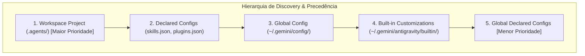

# Matriz de Capacidades do Antigravity e Sistema de Customizações

Data: 2026-11-07  
Versão de Referência: Antigravity 2.29.0 / agy 1.0.13  
Workspace: `C:\Users\ricar\OneDrive\Documentos\Dev\CsBot`

---

## 1. Visão Geral da Arquitetura de Customizações

O Sistema de Customizações do Google Antigravity opera em camadas hierárquicas, combinando regras contextuais, runbooks de procedimentos (Skills), ganchos de ciclo de vida (Hooks), extensões modulares (Plugins) e ferramentas externas (MCP Servers).



---

## 2. Schema e Localização de Rules

Rules definem diretrizes de codificação, restrições arquiteturais e procedimentos obrigatórios.

### 2.1 Localizações Descobertas
1. **Regras de Diretório Hierárquicas**: `GEMINI.md` ou `AGENTS.md` em qualquer nível de pasta. O motor faz o *walk-up* a partir do diretório do arquivo em edição até a raiz do repositório Git, acumulando todas as regras.
2. **Regras do Workspace**: `<workspace_root>/.agents/rules/*.md` ou `<workspace_root>/GEMINI.md`.
3. **Regras Globais**: `~/.gemini/config/GEMINI.md` e `~/.gemini/GEMINI.md`.
4. **Regras de Plugins**: `<plugin_dir>/rules/AGENTS.md` (ou `GEMINI.md`).

### 2.2 Schema e Formato
- Formato: Markdown puro (`.md`).
- Arquivos standalone (`GEMINI.md`/`AGENTS.md`) **não** exigem cabeçalho YAML frontmatter e são sempre ativos (`always_on`) dentro de seu escopo de diretório.
- Suporte a inclusão de arquivos via sintaxe `@[label](caminho_relativo)`.

### 2.3 Orçamentos e Limites de Contexto
- **Limite por Arquivo**: `24.000 bytes` (24 KB) após resolução de includes. Arquivos que excedem o limite são truncados na fronteira de linhas.
- **Orçamento Agregado Global**: `20.000 tokens` (`defaultRulesBudget`). Regras que excedem esse orçamento são despromovidas de texto *inlined* para ponteiros de arquivos com leitura sob demanda.
- **Deduplicação**: Baseada no caminho físico canônico do arquivo (cada regra só é injetada uma única vez por turno).

---

## 3. Schema e Localização de Skills

Skills são procedimentos executáveis, playbooks e guias de fluxo de trabalho ativados sob demanda (Progressive Disclosure).

### 3.1 Localizações
- **Built-in**: `~/.gemini/antigravity/builtin/skills/<skill_name>/`
- **Global**: `~/.gemini/config/skills/<skill_name>/`
- **Workspace**: `<workspace_root>/.agents/skills/<skill_name>/`
- **Plugins**: `<plugin_dir>/skills/<skill_name>/`

### 3.2 Estrutura Canônica de Diretório
```text
skills/<skill_name>/
├── SKILL.md          # [Obrigatório] Instruções e frontmatter
├── scripts/          # [Opcional] Scripts auxiliares (bash, python, ps1)
├── examples/         # [Opcional] Implementações de referência
├── resources/        # [Opcional] Templates e assets estáticos
└── references/       # [Opcional] Documentação densa e manuais
```

### 3.3 Schema do Arquivo `SKILL.md`
```markdown
---
name: nome-da-skill
description: >-
  Descrição em 3ª pessoa indicando exatamente o que a skill faz e quando
  o agente deve ativá-la. Exemplo: "Use esta skill quando..."
---

# Título da Skill

Instruções claras e ordenadas passo a passo.

## Passos Operacionais
1. Executar script de preparação: [preparar.py](./scripts/preparar.py)
2. Validar integridade dos artefatos gerados.
```

- **`name`** (string, obrigatório): Identificador único em letras minúsculas e hífens.
- **`description`** (string, obrigatório): Campo crítico lido pelo modelo para decidir a ativação. Deve ser formulado em terceira pessoa.

---

## 4. Schema e Localização de Hooks

Hooks executam scripts externos de forma síncrona nos principais eventos de ciclo de vida do agente.

### 4.1 Localizações
- **Workspace**: `<workspace_root>/.agents/hooks.json`
- **Global**: `~/.gemini/config/hooks.json`
- **Plugins**: `<plugin_dir>/hooks.json` (deve residir na raiz do plugin)

### 4.2 Schema do Arquivo `hooks.json`
```json
{
  "meu-guardiao-seguranca": {
    "enabled": true,
    "PreToolUse": [
      {
        "matcher": "run_command",
        "hooks": [
          {
            "type": "command",
            "command": "powershell -File ./scripts/validar_seguranca.ps1",
            "timeout": 15
          }
        ]
      }
    ],
    "PostToolUse": [
      {
        "matcher": "write_file|edit_file",
        "hooks": [
          {
            "type": "command",
            "command": "dotnet csharpier check",
            "timeout": 30
          }
        ]
      }
    ],
    "PreInvocation": [
      {
        "type": "command",
        "command": "python ./scripts/injetar_contexto.py",
        "timeout": 10
      }
    ],
    "PostInvocation": [
      {
        "type": "command",
        "command": "python ./scripts/pos_analise.py"
      }
    ],
    "SessionStart": [
      {
        "type": "command",
        "command": "python ./scripts/inicializar_sessao.py"
      }
    ],
    "Stop": [
      {
        "type": "command",
        "command": "python ./scripts/verificar_tarefas_pendentes.py"
      }
    ]
  }
}
```

### 4.3 Tabela de Eventos e Estruturas
| Evento | Momento do Disparo | Alvo do Matcher | Estrutura no JSON |
| :--- | :--- | :--- | :--- |
| `SessionStart` | Início de uma nova sessão | N/A | Flat (lista direta de handlers) |
| `PreToolUse` | Imediatamente antes de executar uma ferramenta | Nome da ferramenta (`run_command`, etc.) | Agrupado (`matcher` + `hooks`) |
| `PostToolUse` | Imediatamente após a conclusão de uma ferramenta | Nome da ferramenta | Agrupado (`matcher` + `hooks`) |
| `PreInvocation` | Antes de enviar o prompt ao modelo | N/A | Flat (lista direta de handlers) |
| `PostInvocation` | Após a conclusão dos passos do modelo | N/A | Flat (lista direta de handlers) |
| `Stop` | Quando o loop de execução tenta finalizar | N/A | Flat (lista direta de handlers) |

---

## 5. Comandos Disponíveis (Slash Commands)

| Comando | Tipo / Origem | Função e Mecanismo de Ação |
| :--- | :--- | :--- |
| `/grill-me` | Nativo do Antigravity | Conduz uma entrevista interativa com o usuário para esclarecer dúvidas de design e alinhar o plano antes de codificar. |
| `/plan` | Nativo do Antigravity | Exige planejamento prévio estruturado passo a passo e emissão de artefato de plano antes da execução. |
| `/teamwork` | Nativo do Antigravity | Orquestra múltiplos agentes e subagentes autônomos trabalhando em paralelo em projetos grandes. |
| `/boost` | Nativo do Antigravity | Ativa raciocínio analítico profundo, perspectivas multifatoriais, checagens adicionais e verificação formal estrita. |
| `/learn` | Nativo do Antigravity | Persiste correções e novos comportamentos estabelecidos pelo usuário nas configurações do agente para sessões futuras. |
| `/graphify` | **Skill Global Ativa** (`~/.gemini/config/skills/graphify/`) | Constrói e consulta um grafo de conhecimento completo do repositório com detecção de comunidades, nós centrais (*god nodes*) e visualização interativa em HTML/GraphRAG. |
| `/goal` | Nativo do Antigravity | Tarefas de longa duração (overnight), mantendo execução contínua e autônoma até o atingimento pleno do objetivo. |
| `/compact` | Nativo do Antigravity | Compacta e resume o histórico da conversa para liberar a janela de contexto. |
| `/schedule` | Nativo do Antigravity | Agenda instruções periódicas (cron) ou temporizadores delayed pontuais. |
| `/browser` | Nativo do Antigravity | Automação e navegação web via Chrome DevTools / Puppeteer. |

---

## 6. Suporte Atual a Subagents

Antigravity possui arquitetura reativa multithread/processo de subagentes autônomos.

### 6.1 Subagentes Pré-Configurados
- **`self`**: Herda o prompt do sistema, ferramentas e modelo configurado do agente pai.
- **`research`**: Subagente somente leitura, operando em sandbox sem acesso à rede, especializado em exploração de código e leitura de documentação.
- **`image-generator`**: Subagente especializado na geração e edição de imagens.

### 6.2 Ferramentas de Orquestração
- **`invoke_subagent`**: Lança o subagente em segundo plano com parâmetros:
  - `TypeName`: Nome do tipo (ex: `self`, `research` ou tipos customizados).
  - `Role`: Título de função com 2 a 5 palavras.
  - `Prompt`: Descrição precisa da tarefa e entregáveis.
  - `Model`: `inherit`, `flash_lite`, `flash`, `pro`.
  - `Workspace`: `inherit`, `branch`, `share`.
- **`define_subagent`**: Cria dinamicamente novos tipos de subagentes registrando `Name`, `Description`, `SystemPrompt`, e concedendo permissões granulares: `EnableWriteTools`, `EnableSubagentTools`, `EnableMCPTools`.
- **`manage_subagents`**: Permite listar instâncias ativas (`list`) e cancelar processos (`kill`, `kill_all`).
- **`send_message`**: Envio de mensagens bidirecionais entre agentes via `ConversationId`.

---

## 7. Suporte a Worktrees e Workspaces Isolados

O parâmetro `Workspace` da ferramenta `invoke_subagent` controla o isolamento físico no disco:

| Modo | Comportamento no Sistema de Arquivos | Caso de Uso |
| :--- | :--- | :--- |
| **`inherit`** (Default) | Compartilha diretamente o mesmo diretório de trabalho do agente pai. | Tarefas de suporte e inspeção no mesmo branch. |
| **`branch`** | Clona/ramifica um workspace isolado e independente do pai. Ao encerrar o subagente (`kill`), a pasta isolada é deletada, preservando artefatos e logs. | Tarefas experimentais de alto risco, testes destrutivos ou compilações pesadas. |
| **`share`** | Compartilha o repositório Git subjacente criando uma **git worktree** (ou Mercurial `hg share`). Permite checkout de branches independentes sem duplicar armazenamento de arquivos. | Desenvolvimento paralelo de features ou testes de integração cross-branch. |

---

## 8. Entrada e Bloqueio de Hooks (Input/Output Contract)

Os hooks comunicam-se exclusivamente via fluxos padrão do sistema operacional (**stdin** para entrada e **stdout** para saída em formato JSON com chaves em camelCase).

### 8.1 Entrada Comum (stdin)
Todos os eventos recebem:
```json
{
  "conversationId": "d65e2bde-5cae-4311-b714-4707e256a192",
  "workspacePaths": ["C:\\Users\\ricar\\OneDrive\\Documentos\\Dev\\CsBot"],
  "transcriptPath": "C:\\Users\\ricar\\.gemini\\antigravity\\brain\\...\\transcript.jsonl",
  "artifactDirectoryPath": "C:\\Users\\ricar\\.gemini\\antigravity\\brain\\...",
  "modelName": "auto",
  "lastUserInput": "Comando do usuário"
}
```

### 8.2 Mecanismo de Bloqueio por Evento

#### 1. `PreToolUse` (Interceptação de Ferramentas)
- **Input adicional**: `toolCall` (`name` e `args`) e `stepIdx`.
- **Resposta em stdout**:
  ```json
  {
    "decision": "deny",
    "reason": "Comando destrutivo não autorizado pelo hook de governança."
  }
  ```
- **Ações de `decision`**:
  - `"deny"`: Bloqueio estrito imediato da execução da ferramenta.
  - `"ask"` / `"force_ask"`: Interrompe a autoexecução e solicita confirmação do usuário.
  - `"allow"`: Permite a execução imediata.
  - `"overwrite"`: Objeto com substituição pontual de argumentos antes da chamada da ferramenta.

#### 2. `PreInvocation` (Interceptação de Prompt do Usuário)
- **Bloqueio em stdout**:
  ```json
  {
    "injectSteps": [
      {
        "errorMessage": {
          "userMessage": "A execução foi abortada porque pré-requisitos de ambiente não foram cumpridos."
        }
      }
    ],
    "terminationBehavior": "terminate"
  }
  ```
  - `"terminationBehavior": "terminate"` interrompe a execução antes da chamada ao modelo.

#### 3. `Stop` (Impedir Conclusão Precoce)
- **Resposta em stdout**:
  ```json
  {
    "decision": "continue",
    "reason": "Testes ou compilação em segundo plano ainda não terminaram."
  }
  ```
  - `"decision": "continue"` força o agente a reentrar no loop de execução.

---

## 9. Precedência entre Hooks Globais e Hooks do Workspace

1. **Mesclagem Sequencial**: Hooks configurados no workspace (`.agents/hooks.json`), nos plugins ativos e no nível global (`~/.gemini/config/hooks.json`) são agregados e executados em série para cada evento.
2. **Princípio Fail-Closed (Prioridade de Bloqueio)**: Se **qualquer** hook (seja do workspace ou global) retornar uma decisão de bloqueio (`"decision": "deny"` ou `"terminationBehavior": "terminate"`), a operação é bloqueada de imediato. Um hook permissivo no workspace **não** pode anular um bloqueio determinado por um hook global.
3. **Precedência de Sobrescrita de Argumentos (`overwrite`)**: Quando múltiplos hooks especificam `"overwrite"`, os valores do **Workspace** sobrepõem as definições globais, seguindo a ordem de precedência:
   $$\text{Workspace} > \text{Plugins} > \text{Global Config}$$

---

## 10. Guia Operacional de Customizações

### 10.1 Como Validar uma Skill
1. **Verificação Estrutural**:
   - A pasta deve estar contida em `skills/<nome-da-skill>/`.
   - O arquivo principal deve ser rigorosamente nomeado `SKILL.md`.
2. **Verificação do Frontmatter YAML**:
   - Delimitado por `---` na primeira linha.
   - Conter `name` válido (apenas letras minúsculas, números e hífens).
   - Conter `description` não-vazia, formulada na terceira pessoa e indicando gatilhos de ativação.
3. **Checagem de Links e Scripts**:
   - Todos os scripts em `scripts/` devem ser executáveis e acessíveis via links relativos no Markdown (`[script.py](./scripts/script.py)`).
   - Manter o `SKILL.md` enxuto, movendo documentação extensa para `references/`.

### 10.2 Como Listar Skills Instaladas
- **Na Interface Desktop (Antigravity 2.0)**: Acessar a barra lateral esquerda $\rightarrow$ menu "Skills & Customizations" para visualizar o catálogo completo de skills, rules e plugins ativos.
- **Pelo CLI (`agy`)**: Executar no terminal:
  ```powershell
  agy plugin list
  ```
- **Pelo Agente**: O bloco `<skills>` é inspecionável no início de cada sessão.
- **Pelo Sistema de Arquivos**: Inspecionar os diretórios `~/.gemini/antigravity/builtin/skills/` (nativas) e `~/.gemini/config/skills/` (globais).

### 10.3 Como Habilitar e Desabilitar uma Skill
- **Se a Skill faz parte de um Plugin**:
  - No arquivo global `~/.gemini/config/config.json`:
    ```json
    {
      "plugins": {
        "<nome-do-plugin>": {
          "enabled": false
        }
      }
    }
    ```
  - Via CLI: `agy plugin disable <nome-do-plugin>` / `agy plugin enable <nome-do-plugin>`.
  - Pela UI: Alternar o seletor correspondente no painel de configurações.
- **Se a Skill é Standalone em `skills/`**:
  - Usar `skills.json` (no workspace ou global) para filtragem explícita:
    ```json
    {
      "entries": [
        {
          "path": "skills",
          "exclude": ["<nome-da-skill>"]
        }
      ]
    }
    ```
  - Ou remover/renomear temporariamente a pasta da skill.

### 10.4 Como Testar Hooks sem Executar Tarefas Reais
Como os hooks operam como processos externos acionados via stdin/stdout, eles podem ser integralmente validados através do terminal sem intervenção do agente:

1. **Criar Payload de Teste Mock (`teste_payload.json`)**:
   ```json
   {
     "conversationId": "mock-test-uuid",
     "workspacePaths": ["C:\\Users\\ricar\\OneDrive\\Documentos\\Dev\\CsBot"],
     "stepIdx": 1,
     "toolCall": {
       "name": "run_command",
       "args": {
         "CommandLine": "rm -rf /"
       }
     }
   }
   ```
2. **Executar via Pipeline de Terminal**:
   - **PowerShell (Windows)**:
     ```powershell
     Get-Content teste_payload.json | cmd /c "seu_script.bat"
     Get-Content teste_payload.json | powershell -File ./meu_hook.ps1
     ```
   - **Bash / Linux**:
     ```bash
     cat teste_payload.json | python ./meu_hook.py
     ```
3. **Validar Critérios de Sucesso**:
   - O stdout emitido deve ser um JSON válido contendo os campos obrigatórios (`decision`, `reason`).
   - O código de saída do processo deve ser `0` (`$?` em PowerShell ou `$LASTEXITCODE == 0`).
   - O tempo de execução deve ser inferior ao `timeout` configurado (padrão 30s).
   - Testar separadamente os cenários de aprovação (`"allow"`), solicitação (`"ask"`) e bloqueio (`"deny"`).
