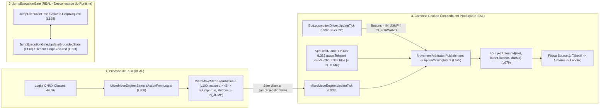
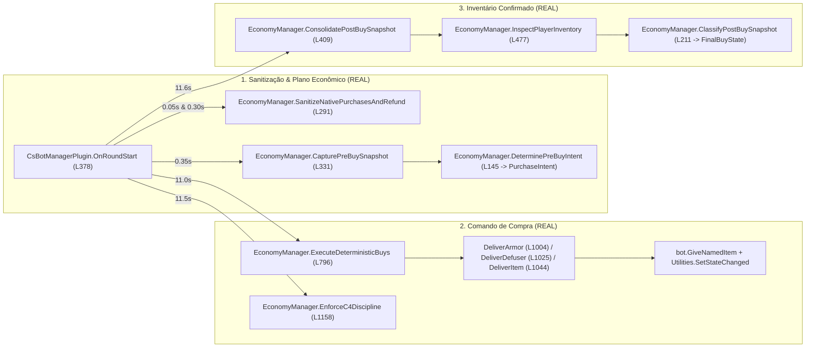

# Inventário do Grafo Arquitetural do Workspace CsBot (`architecture_graph_inventory.md`)

- **Data de Geração**: `2026-11-07T18:12:00Z`
- **Status de Revisão**: `AGENT_REVIEWED` (`csbot-explorer`, `csbot-graph-analyst`, `csbot-adversarial-reviewer`)
- **Natureza dos Dados**:
  - `REAL`: Extração AST estática sobre os arquivos reais em `src/`, `tools/` e `tests/` e grafo persistido em `graphify-out/graph.json`.
  - `INFERRED`: Arestas semânticas inferidas pelo Graphify (`492` de `5.533` arestas) e nós de integração futura do Positioning Transformer (`PLANNED_FUTURE_NODE`).
- **Isolamento Estrito**: Nenhum arquivo de código-fonte em `src/`, `tools/` ou `tests/` foi modificado (`0` bytes alterados em código de produção ou testes).

---

## 1. Proveniência e Estatísticas Globais do Grafo (`graphify-out/`)

### 1.1 Artefatos Brutos e Hashes SHA-256 Completos
- **Comando Reproduzível de Impacto**:
  ```powershell
  C:\Users\ricar\AppData\Local\Programs\Python\Python311\python.exe .agents/skills/csbot-graph-impact/scripts/analyze_graph_impact.py --workspace-root . --graph-path graphify-out/graph.json --target-flow all --output-json .agents/audit/graph_impact_all.json --strict
  ```

| Artefato | Tamanho Exato (Bytes) | Hash SHA-256 Completo (64 caracteres hex) |
|---|---|---|
| `graphify-out/graph.json` | `4.033.979` | `7a09693f1f6568803fa7f2ae7a0286cbe38c09f3900d08b96c6538f4eaa264f0` |
| `graphify-out/GRAPH_REPORT.md` | `37.406` | `c61b333860ee82bcc2dbb9ada62e5458ff671b780ba795d415387913b554e1ae` |
| `.agents/audit/graphify_full_summary.json` | `138.940` | `62bb109fdeee69f4e2ea2e8c2ef2ee6109bc5d459c7454115854d89e832108e5` |
| `.agents/audit/graph_impact_positioning.json` | `22.575` | `155704e067df0e77f34be90073ec2216679954633e88e34cda7bf03b6cbf6a3f` |
| `.agents/audit/graph_impact_mlmove.json` | `5.097` | `1f8e1bc2adf83e5a6ac861528a4d06f9c48a907828aea60408a0accb715bfa6a` |
| `.agents/audit/graph_impact_jump.json` | `18.484` | `b1bbc815e760e6ce9feb2c711287fcf45af28ba5c9670011425918a4e9dd3e9c` |
| `.agents/audit/graph_impact_c4.json` | `21.855` | `9d3abba0ed8c8c70cb571e95ce0c74a1a5e4a9f42536f5a315a857347f85306f` |
| `.agents/audit/graph_impact_recovery.json` | `18.389` | `b53ad2d034a20ee1be805a10b3eb98a38dbcb4abf6560da11bf23e32752e342f` |
| `.agents/audit/graph_impact_economy.json` | `17.229` | `0dc5352b84ec87400c799ca387cdc675eed6a1b0c4d67fb219c3d8eb6bd45d45` |
| `.agents/audit/graph_impact_all.json` | `95.856` | `d05d89e62e16d76508c865780165ebc033974658050efd2cd14a1174ba2489f7` |

### 1.2 Métricas Globais do Grafo (`graphify-out/graph.json`)
- **Total de Nós (`nodes`)**: `2.627`
- **Total de Arestas (`links`)**: `5.533`
  - **Arestas Extraídas via AST (`EXTRACTED`)**: `5.041 / 5.533` (`91.11%`)
  - **Arestas Inferidas (`INFERRED`)**: `492 / 5.533` (`8.89%`)
- **Comunidades Louvain/Leiden Detectadas**: `253` (`224` comunidades principais listadas em `graphify-out/GRAPH_REPORT.md` e `29` unitárias)
- **Componentes Conexas**: `159` (maior componente conexa possui `1.515 / 2.627` nós = `57.67%`)
- **Ciclos de Importação Direcionados (`Import Cycles`)**: `0`
- **Base de Ciclos Não-Direcionados (`nx.cycle_basis`)**: `3.065`
- **Nós Órfãos Estritos (`degree == 0`)**: `96 / 2.627` (`3.65%`)
- **Nós Fracamente Conectados (`degree <= 1`)**: `912 / 2.627` (`34.72%`)

### 1.3 Top 15 God Nodes (Maior Centralidade de Grau no Workspace)

| Rank | Node ID | Símbolo | Grau | Arquivo Fonte | Hash SHA-256 do Arquivo Fonte |
|---|---|---|---|---|---|
| 1 | `src_csbotmanager_models_csbotmanager_tacticalplan` | `TacticalPlan` | `96` | `src/CsBotManager/Models.cs` | `6e18489868b6706d5b93fbcfcf0adb4a3f005bb322d6931a61a41af56f1c2bc9` |
| 2 | `src_csbotmanager_csbotmanagerplugin_csbotmanager_csbotmanagerplugin` | `CsBotManagerPlugin` | `76` | `src/CsBotManager/CsBotManagerPlugin.cs` | `18a69c9d0127c8acec95f68298038dc0a8f705da030a5d20700fcfe9e3a327fb` |
| 3 | `src_csbotmanager_mapprofilemanager_csbotmanager_mapprofilemanager` | `MapProfileManager` | `71` | `src/CsBotManager/MapProfileManager.cs` | `8bcf19cfe74d3071dbdbecd040714f86dfcc22f984779407e0a68e5b5bd08734` |
| 4 | `src_csbotmanager_matchtelemetrylogger_csbotmanager_matchtelemetrylogger` | `MatchTelemetryLogger` | `66` | `src/CsBotManager/MatchTelemetryLogger.cs` | `c0be0dd73a9d520e3355c77574b96a235fccd5330cf991b78dc1390cc183d52b` |
| 5 | `src_csbotmanager_botlocomotiondriver_csbotmanager_botlocomotiondriver` | `BotLocomotionDriver` | `65` | `src/CsBotManager/BotLocomotionDriver.cs` | `7a5b9115cfa1239adcf8576093639e06f27f525f435e3fdac2d74da777b92d0b` |
| 6 | `src_csbotmanager_models` | `Models.cs` | `54` | `src/CsBotManager/Models.cs` | `6e18489868b6706d5b93fbcfcf0adb4a3f005bb322d6931a61a41af56f1c2bc9` |
| 7 | `csharp_namespace:8ba75c39628f7d8f` | `CsBotManager` | `51` | `src/CsBotManager/BotLocomotionDriver.cs` | `7a5b9115cfa1239adcf8576093639e06f27f525f435e3fdac2d74da777b92d0b` |
| 8 | `src_csbotmanager_micromoveengine_csbotmanager_micromoveengine` | `MicroMoveEngine` | `47` | `src/CsBotManager/MicroMoveEngine.cs` | `e1f56099938355fdf2a90018c42e1c2b2575caf55dec16987dcab105428f1954` |
| 9 | `tests_test_phase2_mirage_dataset_invariants_testphase2miragedatasetinvariants` | `TestPhase2MirageDatasetInvariants` | `42` | `tests/test_phase2_mirage_dataset_invariants.py` | `4c506f10ab6fb056e107901f2b82a23f08d6c2c38f1bd916c08a891d0e5b96f2` |
| 10 | `src_csbotmanager_economymanager_csbotmanager_economymanager` | `EconomyManager` | `41` | `src/CsBotManager/EconomyManager.cs` | `032f34410ea4d2f15bef8b40934956805fac378c7326c625421d81c5371cdf5c` |
| 11 | `src_csbotmanager_rolemanager_csbotmanager_rolemanager_getbotrole` | `.GetBotRole()` | `40` | `src/CsBotManager/RoleManager.cs` | `bf2ce47bc6eed7930ba742a40b7d277cea6020d4be77db4d755c66f703f155e8` |
| 12 | `src_csbotmanager_rolemanager_csbotmanager_rolemanager` | `RoleManager` | `39` | `src/CsBotManager/RoleManager.cs` | `bf2ce47bc6eed7930ba742a40b7d277cea6020d4be77db4d755c66f703f155e8` |
| 13 | `src_csbotmanager_movementexecutiontracker_csbotmanager_movementexecutiontracker` | `MovementExecutionTracker` | `38` | `src/CsBotManager/MovementExecutionTracker.cs` | `7b2c8153dd285680eb30126a2d57fcb4ac991644aa60fa5209f08e974d10cd12` |
| 14 | `tests_csbotmanager_tests_v4_2_comprehensivetests_csbotmanager_tests_v4_2_comprehensivetests` | `V4_2_ComprehensiveTests` | `35` | `tests/CsBotManager.Tests/V4_2_ComprehensiveTests.cs` | `3a2e6fb8cb06c4b0e0bf0fb89b8a9b9f56568b9b7010f561a16bf6387ecce42e` |
| 15 | `src_arsenal_web_static_script` | `script.js` | `34` | `src/arsenal_web/static/script.js` | `a2dc5293e067b7f5080f28b922fb1695b3c46374b3ee10c32135a4c1cb59db91` |

---

## 2. Grafo 1 — Positioning Transformer: `dataset → dataloader → checkpoint → export futuro → runtime futuro`

```mermaid
flowchart LR
    subgraph Offline_Dataset ["1. Dataset & Contratos (REAL)"]
        NPZ["444 Shards .npz + 8 .dem"] --> C1["tools/phase2_dataset/step1_2_3_build_contracts.py"]
        NPZ --> C2["tools/phase2_dataset/step4_5_inventory_and_splits.py"]
        C1 --> CAT["mirage_spot_catalog_v3.json (53 spots)"]
        C2 --> SPLITS["train/validation/test_split_v2.json"]
        CAT & SPLITS --> BLD["tools/phase2_dataset/step9_to_18_build_datasets.py"]
        BLD --> PARQ["shard_*.parquet & canonical_test_set.parquet"]
        NPZ --> RARE["tools/phase3a_training/extract_objective_save_events.py"]
        RARE --> OBJ_PARQ["objective_save_sequences.parquet"]
    end

    subgraph Dataloader_Train ["2. DataLoader & Checkpoint (REAL)"]
        PARQ & OBJ_PARQ --> DU["tools/phase3a_training/data_utils.py (InMemoryPositioningDataset)"]
        DU --> MODEL["tools/phase3a_training/positioning_model.py (PositioningTransformerV1)"]
        MODEL --> TRN["tools/phase3a_training/train_full.py"]
        TRN --> CKPT1["models/positioning/de_mirage_positioning_v1.pt"]
        CKPT1 --> FT["tools/phase3a_training/finetune_state_head.py"]
        FT --> CKPT2["models/positioning/de_mirage_positioning_v1_1_candidate.pt"]
    end

    subgraph Future_Bridge ["3. Export & Runtime Futuro (PLANNED_FUTURE_NODE / INFERRED)"]
        CKPT2 -.->|"PLANNED_FUTURE_NODE"| EXP_FUT["Exportador ONNX Futuro (Inexistente)"]
        EXP_FUT -.->|"PLANNED_FUTURE_NODE"| SESS_FUT["Sessão ONNX Posicionamento C# (Inexistente)"]
        SESS_FUT -.->|"Substituirá/Hibridizará"| MAT["src/CsBotManager/TacticalOrderMaterializer.cs"]
        MAT --> DRIVER["src/CsBotManager/BotLocomotionDriver.cs (_botStates)"]
    end
```



### Atributos Arquiteturais (12/12) — Fluxo 1 (`Positioning Transformer`)
1. **`entry_points`**:
   - `tools/phase2_dataset/step1_2_3_build_contracts.py` (`main`, L32-L285): congela o catálogo de 53 spots e 159 perfis de mira.
   - `tools/phase2_dataset/step4_5_inventory_and_splits.py` (`main`, L59-L395): gera inventário e splits por `match_id` sem vazamento.
   - `tools/phase2_dataset/step9_to_18_build_datasets.py` (`build_datasets_and_reports`, L22-L516) e `tools/phase2_dataset/forensic_step2_materialize_shards.py` (`partition_and_audit_dataset`, L31-L94): materializam shards Parquet e `canonical_test_set.parquet`.
   - `tools/phase3a_training/extract_objective_save_events.py` (`extract_from_corpus`, L74-L633): extrai eventos `OBJECTIVE` e `SAVE`.
   - `tools/phase3a_training/train_full.py` (`run_full_training`, L302-L376) e `tools/phase3a_training/finetune_state_head.py` (`main`, L352-L858).
   - `tools/phase3a_training/evaluate_positioning_v1_canonical.py` (`run_canonical_inference`, L47-L220).
   - **Runtime Atual (Pré-ONNX)**: `src/CsBotManager/TacticalUtilityIglEngine.cs` (`DecideRoundPlans`, L148-L192), `src/CsBotManager/TacticalOrderMaterializer.cs` (`MaterializeTacticalOrders`, L12-L432) e `src/CsBotManager/MapProfileManager.cs` (`ResolveBestSpot`, L393-L557).
2. **`authoritative_state`**:
   - Contratos em `datasets/mirage_v2/contracts/mirage_spot_catalog_v3.json`, `datasets/mirage_v2/contracts/spot_semantic_classification.json`, `datasets/mirage_v2/contracts/train_split_v2.json`, `datasets/mirage_v2/contracts/validation_split_v2.json` e `datasets/mirage_v2/contracts/test_split_v2.json`.
   - Vocabulário de classes em `tools/phase3a_training/data_utils.py`: `STATES` (7 classes, L19-L27), `SECTORS` (6 classes, L30-L37), `TRANSITIONS` (7 classes, L45-L53), `EXIT_TRIGGERS` (8 classes, L56-L65) e `INVALID_SPOT_INDEX = 53` (L40-L43).
   - Tensores em `InMemoryPositioningDataset` (`tools/phase3a_training/data_utils.py`, L139-L182): `self_history` `[N, 32, 18]`, `teammate_features` `[N, 32, 4, 18]`, `round_context` `[N, 12]`, `candidate_spot_mask` `[N, 53]`.
   - Checkpoints PyTorch: `models/positioning/de_mirage_positioning_v1.pt` e `models/positioning/de_mirage_positioning_v1_1_candidate.pt`.
   - No runtime C# atual: `BotLocomotionDriver._botStates` (`ConcurrentDictionary<int, TrackedBotNavState>`, L103 de `src/CsBotManager/BotLocomotionDriver.cs`), `TacticalPlan.BotOrders` (`Dictionary<string, BotTacticalOrder>`, L382 de `src/CsBotManager/Models.cs`) e `CsBotManagerPlugin._currentPlan` / `_currentTrPlan` / `_currentCtPlan` (L46-L49 de `src/CsBotManager/CsBotManagerPlugin.cs`).
3. **`writers`**:
   - `step1_2_3_build_contracts.py:main`, `step4_5_inventory_and_splits.py:main`, `step9_to_18_build_datasets.py:build_datasets_and_reports`, `forensic_step2_materialize_shards.py:partition_and_audit_dataset`, `extract_objective_save_events.py:extract_from_corpus`.
   - `tools/phase3a_training/data_utils.py:load_and_preprocess_shard` (L191-L310) e `tools/phase2_dataset/dataloaders.py:PositioningDatasetV1.__getitem__` (L62-L110).
   - `tools/phase3a_training/train_full.py:train_single_seed` (L62-L300) e `tools/phase3a_training/finetune_state_head.py:run_experiment` (L180-L299).
   - No runtime C# atual: `TacticalUtilityIglEngine.DecideRoundPlans` (L148-L192), `TacticalOrderMaterializer.MaterializeTacticalOrders` (L12-L432), `BotLocomotionDriver.NavigateToSpot` (L449-L512) e `BotLocomotionDriver.NavigateToPosition` (L514-L550).
4. **`readers`**:
   - `tools/phase3a_training/positioning_model.py:PositioningTransformerV1.forward` (L142-L206) e `PositioningMultitaskLoss.forward` (L228-L280).
   - `tools/phase3a_training/evaluate_positioning_v1_canonical.py:run_canonical_inference` (L47-L220).
   - No runtime C# atual: `BotLocomotionDriver.UpdateTick` (L652-L1307).
5. **`side_effects`**:
   - Gravação de shards Parquet em `datasets/mirage_v2/positioning/`, checkpoints `.pt` em `models/positioning/` e `training_runs/positioning_v1/`, arrays `.npy` brutos em `training_runs/positioning_v1/canonical_eval/` e relatórios JSON em `training_runs/positioning_v1/finetune_comparison.json`.
6. **`fallbacks`**:
   - Em `PositioningTransformerV1.forward` (`tools/phase3a_training/positioning_model.py`, L190-L199), se uma linha de `candidate_spot_mask` tiver todos os 53 bits `False`, o código habilita todos os spots (`safe_mask[all_false] = True`) antes de aplicar `masked_fill(~safe_mask, -1e9)`.
   - Em `PositioningMultitaskLoss.forward` (L254-L263), se `spot_loss_mask.sum() == 0` no batch, `loss_spot` retorna `0.0`.
7. **`telemetry`**:
   - `training_runs/positioning_v1/canonical_eval/canonical_eval_manifest.json` e `training_runs/positioning_v1/finetune_comparison.json`.
   - No runtime C# atual: `src/CsBotManager/GameplaySpotTelemetryTracker.cs` (`OnSpotAssigned` L124, `OnSpotReached` L133, `OnSpotReplaced` L169, `OnSpotAbandoned` L182) e `src/CsBotManager/LiveRadarTelemetryService.cs` (`UpdateTick`, L108-L400).
8. **`tests`**:
   - Python: `tests/test_phase2_mirage_dataset_invariants.py`, `tests/test_phase2_2_training_inputs.py`, `tests/test_phase3a_positioning_training.py`, `tests/test_phase3a_1_forensic_reconciliation.py`, `tests/test_phase3a_2_objective_save_enrichment.py`.
   - C#: `tests/CsBotManager.Tests/Phase2DatasetInvariantsTests.cs`, `tests/CsBotManager.Tests/Phase2ForensicAuditTests.cs`, `tests/CsBotManager.Tests/Phase2TrainingInputsTests.cs`.
9. **`uncovered_nodes`**:
   - **Export Futuro e Runtime Futuro (`PLANNED_FUTURE_NODE` / `INFERRED`)**: não há exportador ONNX nem `InferenceSession` C# para `PositioningTransformerV1`.
   - **Máscara Restritiva Real nos Shards**: em `tools/phase3a_training/data_utils.py` (`load_and_preprocess_shard`, L253), `candidate_spot_mask` é preenchido com `np.ones((n, 53), dtype=bool)`.
10. **`cycles`**:
    - `0` ciclos de runtime (modelo ainda offline). Ciclo experimental supervisionado entre avaliação canônica V1 (`evaluate_positioning_v1_canonical.py`) → enriquecimento de estados raros (`extract_objective_save_events.py`) → fine-tuning controlado (`finetune_state_head.py`).
11. **`legacy_apis`**:
    - Coexistência de dois DataLoaders: `tools/phase2_dataset/dataloaders.py` (`PositioningDatasetV1`, L36-L110) e `tools/phase3a_training/data_utils.py` (`InMemoryPositioningDataset`, L139-L182).
12. **`high_risk_mutation_points`**:
    - **CRÍTICO (`SYNTHETIC` / `TEMPLATED`)**: em `tools/phase3a_training/data_utils.py` (`load_and_preprocess_shard`, L217-L238), `self_history` `[N, 32, 18]` não carrega 32 ticks históricos reais do Parquet, mas repete a posição atual aplicando drift linear `np.linspace(-0.01, 0.0, 32)`, fixa `health = 1.0`, zera as features `5..17` e sintetiza `teammate_features` `[N, 32, 4, 18]` somando `(i + 1) * 0.05` à posição do próprio jogador.
    - **CRÍTICO (`TEMPLATED`)**: em `tools/phase2_dataset/step1_2_3_build_contracts.py` (L186-L229), os ângulos `SECONDARY` (`primary_yaw +/- 45.0`) e `SUPPORT_UTILITY_LINEUP` (`pitch = -25.0`) são calculados por offset fixo sobre o yaw primário.

---

## 3. Grafo 2 — MLMove V1: `ONNX → inferência → MovementArbitrator → usercmd`

```mermaid
flowchart LR
    subgraph Train_Export ["Pipeline Python MLMove V1 (REAL)"]
        SHARDS["Shards 16Hz (*_X.npy / *_Y.npy)"] --> TRN_ONNX["tools/mlmove_pipeline/train_and_export_onnx.py"]
        TRN_ONNX --> ONNX_FILE["models/mlmove_{map}.onnx"]
    end

    subgraph Runtime_16Hz ["Inferência C# 16Hz / 64Hz (REAL)"]
        ONNX_FILE --> LOAD["MicroMoveEngine.TryLoadMapModel / OnModelFileDetected"]
        TICK64["CsBotManagerPlugin.OnTick -> BotLocomotionDriver.UpdateTick"] --> MME_TICK["MicroMoveEngine.UpdateTick (L933)"]
        MME_TICK --> B16["MicroMoveEngine.PredictBatch16Hz (L1171)"]
        LOAD & B16 --> FOW["MicroMoveEngine.BuildFogOfWarInputTensorForTeam (L1085)"]
        FOW --> RUN["MicroMoveEngine.RunOnnxBatchInference (L717)"]
        RUN --> SAMPLE["MicroMoveEngine.SampleActionFromLogits (L808)"]
        SAMPLE --> TRAJ["MicroMoveEngine._trajectories[slot] (Step0_Now / Step1_125ms / Step2_250ms)"]
    end

    subgraph Arbitrator_Engine ["MovementArbitrator & Engine 64Hz (REAL)"]
        TRAJ --> PUB["MovementArbitrator.PublishIntent / PublishDuringCollection"]
        PUB --> RES["MovementArbitrator.ResolveAllIntents / CollectAndResolveIntents"]
        RES --> APP["MovementArbitrator.ApplyWinningIntent (L592)"]
        APP --> UCMD["api.StartUsercmdMovement + api.InjectUsercmd + bot.GoalPosition"]
        UCMD -.->|"Feedback Físico Próximo Tick"| MME_TICK
    end
```



### Atributos Arquiteturais (12/12) — Fluxo 2 (`MLMove V1`)
1. **`entry_points`**:
   - Python: `tools/mlmove_pipeline/extract_16hz_tensors.py` (`extract_demo_to_16hz_shards`, L186-L315), `tools/mlmove_pipeline/train_and_export_onnx.py` (`train_map_model`, L285-L388; `export_to_server_onnx`, L209-L283) e `tools/mlmove_pipeline/validate_e2e_onnx.py` (`validate_onnx_model`, L14-L98).
   - Runtime C#: `src/CsBotManager/MicroMoveEngine.cs` (`EnsureModelsDirectory` L583, `OnModelFileDetected` L606, `TryLoadMapModel` L647, `UpdateTick` L933, `PredictBatch16Hz` L1171), `src/CsBotManager/BotLocomotionDriver.cs` (`UpdateTick`, L652-L1307) e `src/CsBotManager/MovementArbitrator.cs` (`BeginTick` L180, `PublishDuringCollection` L287, `PublishIntent` L424, `CloseCollectionWindow` L455, `ResolveAllIntents` L463, `CollectAndResolveIntents` L505, `ApplyWinningIntent` L592, `EndTick` L496).
2. **`authoritative_state`**:
   - Contrato em `tools/mlmove_pipeline/contract_spec.py` (`SEQ_LEN=32`, `MAX_PLAYERS=10`, `NUM_PLAYER_FEATURES=18`, `NUM_ACTION_CLASSES=97`, `PREDICTION_HORIZONS=[0, 2, 4]`).
   - Em `src/CsBotManager/MicroMoveEngine.cs`: `_onnxLock` (L285), `_trajectories` (`ConcurrentDictionary<int, MicroMoveTrajectory>`, L290), `_ctFogInputTensor` (`float[MaxPlayers, FeatureDim]`, L291), `_trFogInputTensor` (`float[MaxPlayers, FeatureDim]`, L292), `_onnxBatchInputBuffer` (`float[2 * MaxPlayers * FeatureDim]`, L293), `_onnxBatchOutputLogits` (`float[2, MaxPlayers, HorizonsCount, ActionSpaceSize]`, L294) e `_onnxSession` (`InferenceSession?`, L295).
   - Em `src/CsBotManager/MovementArbitrator.cs`: `_collectingIntentsBySlot` (`ConcurrentDictionary<int, List<MovementIntent>>`, L150), `_queuedIntentsForNextTickBySlot` (L151), `_lastDecisionsBySlot` (`ConcurrentDictionary<int, ArbitratedMovementDecision>`, L152), `_activeUsercmdHandleBySlot` (L153), `_lastAppliedTickBySlot` (L154), `CurrentPhase` (`ArbitrationWindowPhase`, L170) e `CurrentInternalRoundId` (L173).
3. **`writers`**:
   - `MicroMoveEngine.BuildStandardizedInputTensor` (L1075-L1083), `BuildFogOfWarInputTensorForTeam` (L1085-L1169), `RunOnnxBatchInference` (L717-L801) e `PredictBatch16Hz` (L1171-L1592: atualiza `traj.Step0_Now`, `traj.Step1_125ms`, `traj.Step2_250ms` em `_trajectories[slot]`).
   - `MovementArbitrator.BeginTick` (L180-L245), `PublishDuringCollection` (L287-L352), `QueueForNextTick` (L354-L422), `PublishIntent` (L424-L453), `ResolveAllIntents` (L463-L481), `CollectAndResolveIntents` (L505-L587) e `ApplyWinningIntent` (L592-L764).
4. **`readers`**:
   - `MicroMoveEngine.GetTrajectory` (L803-L806) e `MicroMoveStep.GetStepForElapsed` (`MicroMoveTrajectory.GetStepForElapsed`, L212-L238) lidos por `MicroMoveEngine.UpdateTick` (L933-L1073) e `BotLocomotionDriver.UpdateTick` (L887-L893).
   - `MovementArbitrator.GetLastDecision` (L766-L769) e `GetActiveUsercmdHandle` (L168), além de `MovementExecutionTracker.RecordOrUpdateIntentIssued` (L545-L603) e `UpdateTick` (L888-L1022).
5. **`side_effects`**:
   - Chamadas nativas em `MovementArbitrator.ApplyWinningIntent` (L640-L763):
     - `api.CancelUsercmdMovement(slot, oldHandle)` (L645, L670) e `api.StartUsercmdMovement(slot, fMove, sMove)` (L661) com clamp 2D em `Config.MaxArtificialSpeed2D` (`250.0f` u/s, L651-L657).
     - `api.InjectUsercmd(slot, intent.Buttons, Math.Clamp(intent.ButtonsDurationMs, 50, 1000))` (L679).
     - `bot.IsStopping` / `bot.WaitTimer` (L687-L696).
     - `bot.GoalPosition[0..2] = valResult.SanitizedGoal.X/Y/Z` (validado por `MapPlayableBounds.ValidateGoal`, L716-L722) e `bot.RepathTimer.Timestamp = 0f` (L727).
     - `bot.LookAtSpot[0..2]` (L748-L760).
6. **`fallbacks`**:
   - Quando `_onnxSession == null` ou `RunOnnxBatchInference` retorna `false`, `PredictBatch16Hz` (L1171-L1592) ainda executa overrides determinísticos (Counter-Strafe `EvaluateCounterStrafeEligibility` L459, Trade Spacing `TryEvaluatePairRepulsion` L367, Wall-Hugging em chokepoints L1452-L1486) ou desativa `traj.IsOverrideActive = false` (L1589), cedendo controle ao NavMesh (`NavMesh_GPS`).
   - Em `PredictBatch16Hz` (L1506-L1543), se o modelo ONNX amostrar `act0 == 0` (`StandStill`) com o bot quase parado (`speed2D < 25.0f`), faz fallback para `act1` (`125ms`), `act2` (`250ms`) ou o segundo melhor logit (`secondAct`).
   - Em `MovementArbitrator.PublishDuringCollection` (L287-L352), intents de rounds obsoletos (`intent.InternalRoundId != CurrentInternalRoundId`), expirados ou com revisão de objetivo C4 divergente são descartados antes da resolução.
7. **`telemetry`**:
   - `MicroMoveEngine.LastInferenceLatencyMs` (L309), `TotalOnnxInferences` (L310) e `LogDebugWithCooldown` (`MLMOVE - ONNX 16HZ`, L1580-L1585).
   - `MovementArbitrator.TotalResolvedIntents` (L163), `TotalConflictsSuppressed` (L164), `TotalApplications` (L165) e log `ARBITRAGEM - MOVIMENTO` em `ApplyWinningIntent` (L624-L626).
   - `MovementExecutionTracker.UpdateTick` (L888-L1022) e `TrackerMetricsAggregator.GenerateAggregatedReport` (`src/CsBotManager/TrackerMetricsAggregator.cs`, L257-L905).
8. **`tests`**:
   - Python: `tests/test_movement_contract_v2.py` e `tools/mlmove_pipeline/validate_e2e_onnx.py`.
   - C#: `tests/CsBotManager.Tests/MovementArbitrationAndStuckTests.cs`, `tests/CsBotManager.Tests/TickDeltaAndAppliedIntentTests.cs`, `tests/CsBotManager.Tests/V4_2_4_PrecisionTests.cs`, `tests/CsBotManager.Tests/V4_2_5_PrecisionTests.cs`, `tests/CsBotManager.Tests/V4_2_6_PrecisionTests.cs` e `tests/CsBotManager.Tests/V4_2_7_PrecisionTests.cs`.
9. **`uncovered_nodes`**:
   - `MicroMoveEngine.RunOnnxBatchInference` (L717-L801) e `EnsureModelsDirectory` / `OnModelFileDetected` (L583-L613) não possuem teste unitário xUnit C# com sessão `.onnx` carregada.
   - O ramo nativo de `MovementArbitrator.ApplyWinningIntent` (L640-L763) que invoca `api.StartUsercmdMovement` e `api.InjectUsercmd` depende de ponteiros nativos do servidor CS2.
10. **`cycles`**:
    - Loop fechado de controle físico 64Hz/16Hz: `MicroMoveEngine.PredictBatch16Hz` → `MicroMoveEngine.UpdateTick` publica `MovementIntent` → `MovementArbitrator.ApplyWinningIntent` (`api.StartUsercmdMovement` / `api.InjectUsercmd`) → física Source 2 altera posição/velocidade do `CCSPlayerPawn` → lido de volta por `BuildStandardizedInputTensor` no próximo ciclo de 16Hz.
11. **`legacy_apis`**:
    - Constante hardcoded `DefaultModelsDir = @"H:\CS2_AI_Server\models"` em `src/CsBotManager/MicroMoveEngine.cs` (L280).
    - Conflito entre `tools/mlmove_pipeline/contract_spec.py` (97 classes com Jump acoplado nas classes `49..96`) e o contrato V2.1 da Fase 2 (`tools/phase2_dataset/step6_7_8_jump_and_movement.py`, que separa movimento terrestre de eventos de pulo).
12. **`high_risk_mutation_points`**:
    - **BUG (`tools/mlmove_pipeline/run_mining_and_training_loop.py`, L202)**: `X, Y = load_dataset_for_map(map_name)` falha porque `load_dataset_for_map` (`tools/mlmove_pipeline/train_and_export_onnx.py`, L198-L207) retorna um objeto `ShardedMemmapDataset`, e não uma tupla `(X, Y)`.
    - **Risco de Truncamento Temporal no Input Tensor C# (`MicroMoveEngine.cs`, L291-L293 e L717-L801)**: `_ctFogInputTensor` e `_trFogInputTensor` armazenam apenas o frame instantâneo `[10, 18]` (`2 * 10 * 18` floats em `_onnxBatchInputBuffer`), enquanto o modelo Python em `contract_spec.py` especifica janelas `[N, 32, 10, 18]`.

---

## 4. Grafo 3 — Jump: `previsão → JumpExecutionGate → comando → landing`



### Atributos Arquiteturais (12/12) — Fluxo 3 (`Jump`)
1. **`entry_points`**:
   - Offline: `tools/phase2_dataset/step6_7_8_jump_and_movement.py` (`extract_jump_episodes_and_movement`, L22-L226).
   - Gate: `src/CsBotManager/JumpExecutionGate.cs` (`UpdateGroundedState` L148, `EvaluateJumpRequest` L198, `RecordJumpExecuted` L353).
   - Runtime Real: `src/CsBotManager/MicroMoveEngine.cs` (`MicroMoveStep.FromActionId` L100-L142, `PredictBatch16Hz` L1492-L1575, `UpdateTick` L933-L1073), `src/CsBotManager/BotLocomotionDriver.cs` (`UpdateTick` Stuck 2D recovery, L979-L1000) e `src/CsBotManager/SpotTestRunner.cs` (`OnTick`, L358-L396).
2. **`authoritative_state`**:
   - Em `src/CsBotManager/JumpExecutionGate.cs`: `_states` (`ConcurrentDictionary<int, JumpGateState>`, L82) onde `JumpGateState` (`sealed class`, L9-L21) armazena `LastJumpIssuedTick`, `LastGroundedTick`, `LastLandingTick`, `JumpPressedLastTick`, `ConsecutiveJumpPredictions`, `ConsecutiveAirborneTicks`, `IsGrounded` e `RepeatedJumpSequenceDetected`, além de `EmittedEvents` (`List<JumpGateEvent>`, L88).
   - Em `src/CsBotManager/MicroMoveEngine.cs`: `MicroMoveStep.IsJump` (`bool`, L63) e `MicroMoveStep.Buttons` (`ulong`, L67).
3. **`writers`**:
   - `JumpExecutionGate.GetOrCreateState` (L94), `RecordEvent` (L99), `UpdateGroundedState` (L148-L186), `EvaluateJumpRequest` (L198-L351), `RecordJumpExecuted` (L353-L360) e `ResetRound` (L362-L365).
   - `MicroMoveStep.FromActionId` (L100-L142: define `isJump = idx >= 48` e `buttons |= 1UL << 1`).
4. **`readers`**:
   - `JumpExecutionGate.IsGrounded` (L188-L196).
   - `MovementArbitrator.ApplyWinningIntent` (L675-L682: lê `intent.Buttons != 0UL` e invoca `api.InjectUsercmd`).
5. **`side_effects`**:
   - Injeção do bit `IN_JUMP` (`1UL << 1`) via `api.InjectUsercmd(slot, intent.Buttons, Math.Clamp(intent.ButtonsDurationMs, 50, 1000))` em `MovementArbitrator.ApplyWinningIntent` (L679).
   - Em `SpotTestRunner.OnTick` (L358-L362), aplica impulso vertical cinemático `curVz = 260.0f` diretamente via `pawn.Teleport(null, new QAngle(0, desiredYaw, 0), new Vector(dirX * 225.0f, dirY * 225.0f, curVz))` além de publicar `btns |= BotLocomotionDriver.IN_JUMP` (L369-L372).
6. **`fallbacks`**:
   - Em `JumpExecutionGate.EvaluateJumpRequest` (L231), quando um `actionId0` de pulo (`49..96`) é bloqueado por qualquer guarda (airborne, cooldown, freeze time, combate/hold, plant/defuse, save, falta de contexto de travessia ou falta de confirmação em `actionId1`), ele é convertido para a ação terrestre equivalente sem pulo: `convertedNonJumpAction = actionId0 > 48 ? (actionId0 - 48) : actionId0`.
7. **`telemetry`**:
   - `JumpExecutionGate.EmittedEvents` (`List<JumpGateEvent>`, L88), `JumpExecutionGate.RecordEvent` (L99-L146) e `TrackerMetricsAggregator.RecordJump` / `IncrementRepeatedJumpSequences` (`src/CsBotManager/TrackerMetricsAggregator.cs`, L171-L196).
8. **`tests`**:
   - C#: `tests/CsBotManager.Tests/Phase17SemanticAndJumpTests.cs` (`Test4` a `Test7`, L89-L210) e `tests/CsBotManager.Tests/V4_2_8_PrecisionTests.cs`.
   - Python: `tests/test_movement_contract_v2.py` (L27-L87) e `tests/test_phase2_2_training_inputs.py` (L57-L70).
9. **`uncovered_nodes`**:
   - Integração de `JumpExecutionGate` com `MicroMoveEngine.PredictBatch16Hz`, `BotLocomotionDriver.UpdateTick` e `MovementArbitrator` no loop real de tick (`OnTick`).
10. **`cycles`**:
    - Ciclo de estado de pulo em `JumpExecutionGate` (`JumpGateState`, L9-L21): `IsGrounded = true` → `EvaluateJumpRequest` autoriza e `RecordJumpExecuted` grava `LastJumpIssuedTick` → `UpdateGroundedState` detecta `isGrounded = false` (`ConsecutiveAirborneTicks++`) → no retorno a `isGrounded = true`, registra `LastLandingTick = currentTick` e `JumpGateEventType.JumpLanded` → aplica `JumpCooldownSeconds` (`3.5f` s).
11. **`legacy_apis`**:
    - Pulo acoplado à recuperação de Stuck 2D (`Buttons = IN_JUMP | IN_FORWARD`) em `BotLocomotionDriver.UpdateTick` (L992).
    - Impulso vertical direto `curVz = 260.0f` via `pawn.Teleport` em `SpotTestRunner.OnTick` (L360-L362).
12. **`high_risk_mutation_points`**:
    - **CRÍTICO (`JumpExecutionGate` Desconectado em Produção)**: `src/CsBotManager/JumpExecutionGate.cs` (L80-L384) nunca é instanciado nem chamado em `CsBotManagerPlugin.cs`, `MicroMoveEngine.cs`, `BotLocomotionDriver.cs` ou `MovementArbitrator.cs`. Só é instanciado nos testes unitários (`Phase17SemanticAndJumpTests.cs`). Assim, qualquer classe `49..96` amostrada em `MicroMoveEngine.PredictBatch16Hz` (L1496, L1567) vira `IN_JUMP` sem passar pelas guardas de `JumpExecutionGate.EvaluateJumpRequest`.

---

## 5. Grafo 4 — C4: `eventos → BombObjectiveState → materialização → movimento → plant/retake`

```mermaid
flowchart LR
    subgraph Events ["1. Eventos & Pivôs (REAL)"]
        EV_START["CsBotManagerPlugin.OnRoundStart (L378)"] --> MAT_TR["TacticalOrderMaterializer.MaterializeTrOrders (L632)"]
        EV_PIVOT["TrMacroPivotController (TriggerBrickWallPivot L317 / CheckMidRoundExploitPick L608)"] --> BSTATE["TacticalPlan.BombObjectiveState (L412 / L985)"]
        EV_PLANT["CsBotManagerPlugin.OnBombPlanted (L932)"] --> BSTATE
    end

    subgraph Materialization ["2. Materialização de Ordens (REAL)"]
        MAT_TR --> BSTATE
        BSTATE --> PARSER["BombsiteParser.ResolveBombCarrierTargetSite (Models.cs L675)"]
        PARSER --> VAL_ORD["TacticalOrderMaterializer.ValidateAndRepairOrders (L735)"]
        EV_PLANT --> MAT_CT["TacticalOrderMaterializer.MaterializeCtRetakeOrdersDeterministic (L914)"]
        VAL_ORD & MAT_CT --> NAV_SPOT["BotLocomotionDriver.NavigateToSpot (L449) / NotifyBombState (L339)"]
    end

    subgraph Execution ["3. Movimento, Plant & Retake (REAL)"]
        NAV_SPOT --> TICK["BotLocomotionDriver.UpdateTick (L719-L875)"]
        TICK --> PLANT["SiteClearAndPlantController.IsSiteSafeToPlant (L63) & AnnounceAndStartPlant (L163)"]
        TICK --> RETAKE["CtRetakeAndDefuseBrain.TryDeploySmokeOnC4 (L70) / ShouldInjectDefuseInput (L285)"]
        PLANT & RETAKE --> ARB_C4["MovementArbitrator.PublishIntent (Source=BombObjective)"]
    end
```



### Atributos Arquiteturais (12/12) — Fluxo 4 (`C4`)
1. **`entry_points`**:
   - Eventos em `src/CsBotManager/CsBotManagerPlugin.cs`: `OnRoundStart` (L378-L672), `OnBombPlanted` (L932-L956) e `OnBombBeginDefuse` (L958-L980).
   - Pivôs e adaptação: `src/CsBotManager/TrMacroPivotController.cs` (`EvaluateSiteClearance` L108, `ResolveFirstKillExploitContext` L208, `CheckBrickWallOnEntryDeath` L275, `CheckBrickWallOnHeavyUtility` L293, `CheckLurkerSiteClearance` L492, `CheckMidRoundExploitPick` L608) e `src/CsBotManager/MidRoundAdapter.cs` (`HandleBombPlanted` L405, `HandleBombBeginDefuse` L460, `TriggerSilentRotate` L502).
   - Materialização e execução: `src/CsBotManager/TacticalOrderMaterializer.cs` (`MaterializeTrOrders` L632, `ValidateAndRepairOrders` L735, `MaterializeCtRetakeOrders` L872, `MaterializeCtRetakeOrdersDeterministic` L914), `src/CsBotManager/SiteClearAndPlantController.cs` (`IsSiteSafeToPlant` L63, `GetPlantPosition` L123, `AnnounceAndStartPlant` L163), `src/CsBotManager/CtRetakeAndDefuseBrain.cs` (`TryDeploySmokeOnC4` L70, `DecideDefuseStrategy` L112, `OnDefuseTapped` L166, `CheckAndEnforceSmartDefusePriority` L243, `ShouldInjectDefuseInput` L285) e `src/CsBotManager/BotLocomotionDriver.cs` (`NotifyBombState` L339, `UpdateTick` L719-L875).
2. **`authoritative_state`**:
   - `BombObjectiveState` em `src/CsBotManager/Models.cs` (L985-L1039), armazenado em `TacticalPlan.BombObjectiveState` (L412): `InternalRoundId`, `SourceDecisionId`, `SourceTacticId`, `MaterializedRealSite`, `FakeSite`, `CommittedSite`, `RealSite`, `PlantedSite`, `ObjectiveRevision` (`Guid`, L995) e `UpdatedAtTick`.
   - `SiteClearAndPlantController` (`src/CsBotManager/SiteClearAndPlantController.cs`, L7-L194) e `CtRetakeAndDefuseBrain` (`src/CsBotManager/CtRetakeAndDefuseBrain.cs`, L16-L330).
   - Em `src/CsBotManager/BotLocomotionDriver.cs`: `_isBombPlanted`, `_bombPosition`, `_isTacticalSaveActive` (atualizados por `NotifyBombState` L339-L395 e `NotifySaveState` L397-L400) e `C4MismatchTracker` (`C4MismatchEpisodeTracker`, L91).
3. **`writers`**:
   - `BombObjectiveState.CommitMaterializedSite` (L1000-L1018), `UpdateCommittedSite` (L1020-L1030) e `MarkPlanted` (L1032-L1039) em `src/CsBotManager/Models.cs`, além de `TacticalPlan.ApplyPivotRevision` (L546-L577) e `SetFakeExecution` (L579-L604).
   - `TacticalOrderMaterializer.MaterializeTrOrders` (L632-L713), `ValidateAndRepairOrders` (L735-L870) e `MaterializeCtRetakeOrdersDeterministic` (L914-L1104).
   - `BotLocomotionDriver.NotifyBombState` (L339-L395) e `NavigateToSpot` (L449-L512).
4. **`readers`**:
   - `BombsiteParser.ResolveBombCarrierTargetSite` (`src/CsBotManager/Models.cs`, L675-L724).
   - `MovementArbitrator.PublishDuringCollection` (`src/CsBotManager/MovementArbitrator.cs`, L314-L333: lê `GetActiveBombObjectiveState?.Invoke()` para rejeitar intents com `ObjectiveRevision` ou `TargetSpotAssociatedBombsite` obsoletos).
5. **`side_effects`**:
   - Em `BotLocomotionDriver.UpdateTick` (L738-L784): publica `MovementIntent` (`Source = MovementIntentSource.BombObjective`, `Kind = MovementCommandKind.ReleaseHoldAndRepath` ou `NavigateNavMesh`).
   - Em `BotLocomotionDriver.UpdateTick` (L845-L871): para o CT defuser, publica `MovementIntent` (`Source = MovementIntentSource.BombObjective`, `Buttons = IN_USE`, `ButtonsDurationMs = 300`), ou executa `controller.ExecuteClientCommand("-use; slot1")` quando em `_isTacticalSaveActive` (L795).
   - Callouts táticos em `SiteClearAndPlantController.AnnounceAndStartPlant` (L163-L193).
6. **`fallbacks`**:
   - `TacticalOrderMaterializer.ValidateAndRepairOrders` (L735-L870) e `PresetSpatialValidator.ValidateAndApplyFallback` (`src/CsBotManager/PresetSpatialValidator.cs`, L253-L291) corrigem ordens onde o portador da C4 recebeu um spot do site errado ou fora dos limites jogáveis.
7. **`telemetry`**:
   - `src/CsBotManager/C4MismatchEpisodeTracker.cs` (`RecordSemanticMismatch` L23, `RecordMismatch` L29, `ResolveEpisode` L59) e `src/CsBotManager/TrackerMetricsAggregator.cs` (`UniqueC4MismatchEpisodes` L106, `TotalMismatchTicks` L108, `StaleObjectivesRejected` L110, `RetakeSiteMismatches` L112, `C4SemanticMismatches` L114).
8. **`tests`**:
   - `tests/CsBotManager.Tests/V4_2_6_PrecisionTests.cs`, `tests/CsBotManager.Tests/V4_2_7_PrecisionTests.cs`, `tests/CsBotManager.Tests/V4_2_8_PrecisionTests.cs`, `tests/CsBotManager.Tests/OrganicRushesAndFakesTests.cs` e `tests/CsBotManager.Tests/GeographyAndPivotTests.cs`.
9. **`uncovered_nodes`**:
   - O bloco de plant/defuse dentro de `BotLocomotionDriver.UpdateTick` (L719-L875) que consome `CCSPlayerController` nativo não possui cobertura unitária direta.
10. **`cycles`**:
    - Ciclo de adaptação C4: `TrMacroPivotController` (`TriggerBrickWallPivot` L317 / `CheckMidRoundExploitPick` L608) → `TacticalPlan.ApplyPivotRevision` (L546) e `BombObjectiveState.UpdateCommittedSite` (L1020, gera novo `ObjectiveRevision`) → `TacticalOrderMaterializer.MaterializeTrOrders` (L632) → `BotLocomotionDriver.NavigateToSpot` (L449).
11. **`legacy_apis`**:
    - Coordenadas hardcoded de bombsites da Mirage (`new Vector(-1190.0f, -150.0f, -165.0f)` e `new Vector(-1160.0f, -2450.0f, -168.0f)`) e parse de string `(_plugin?.CurrentPlan?.TacticName ?? "").Contains("B")` em `BotLocomotionDriver.UpdateTick` (L758-L760, L1063, L1117).
12. **`high_risk_mutation_points`**:
    - **CRÍTICO 1 (`GetActiveBombObjectiveState` Nunca Conectado)**: em `src/CsBotManager/MovementArbitrator.cs` (L146), o delegate `GetActiveBombObjectiveState` nunca é atribuído em `CsBotManagerPlugin.Load` (L158-L279), permanecendo `null` no servidor real.
    - **CRÍTICO 2 (Hardcoding `"A"` no Plant)**: em `src/CsBotManager/BotLocomotionDriver.cs` (L735), `PlantController.AnnounceAndStartPlant(controller, "A", aliveTrs, aliveCts)` passa a string literal `"A"` mesmo quando o plant ocorre no site B.
    - **CRÍTICO 3 (Leitura de `_plugin?.CurrentPlan` do Time Humano)**: em `BotLocomotionDriver.UpdateTick` (L758, L1063, L1117), bots TR consultam `_plugin?.CurrentPlan` (que aponta para o plano CT quando o humano joga de CT, conforme `CsBotManagerPlugin.OnRoundStart` L560) para decidir o bombsite alvo.

---

## 6. Grafo 5 — Recovery: `detecção → classificação → stages → resultado físico`

```mermaid
flowchart LR
    subgraph Detection ["1. Detecção de Imobilidade (REAL)"]
        TICK_DRV["BotLocomotionDriver.UpdateTick (L895-L927)"] --> EVAL_2D["BotLocomotionDriver.EvaluateStuck2DWindow (L170)"]
        MET_STUCK["MovementExecutionTracker.UpdateTick (L888)"] --> OUT_CLS["MovementExecutionTracker.ClassifyPhysicalOutcomeDetailed (L797)"]
    end

    subgraph Classification ["2. Classificação (REAL)"]
        EVAL_2D --> CLS["MicroMoveEngine.ClassifyStandstillState (L242) / ShouldMonitorForStuck (L279)"]
        CLS -->|"AuthorizedHold / Combat / Plant"| IGNORE["Isento de Recovery"]
        CLS -->|"IsStuck2D == true"| STAGES["Escalonamento NewStuckStage (L926)"]
    end

    subgraph Stages_Physical ["3. Stages & Resultado Físico (REAL)"]
        STAGES --> BLK["BlacklistWaypoint (L941) + Substituição por FallbackSpotId / GetSpotsForTeam (L943-L965)"]
        BLK --> PUB_UNSTUCK["MovementArbitrator.PublishIntent (L979: Source=Unstuck, ForwardMove=140, SideMove=+/-220, IN_JUMP|IN_FORWARD)"]
        PUB_UNSTUCK --> VERIFY["MovementExecutionTracker.CompleteSample (L1024: valida disp2D em 125ms/250ms/500ms)"]
    end
```



### Atributos Arquiteturais (12/12) — Fluxo 5 (`Recovery`)
1. **`entry_points`**:
   - Detecção: `src/CsBotManager/BotLocomotionDriver.cs` (`EvaluateStuck2DWindow` L170-L243, `UpdateTick` L895-L1004) e `src/CsBotManager/MovementExecutionTracker.cs` (`UpdateTick`, L888-L1022).
   - Classificação: `src/CsBotManager/MicroMoveEngine.cs` (`ClassifyStandstillState`, L242-L261), `src/CsBotManager/BotLocomotionDriver.cs` (`ShouldMonitorForStuck`, L279-L293) e `src/CsBotManager/MovementExecutionTracker.cs` (`ClassifyPhysicalOutcomeDetailed` L797-L872, `ClassifyPhysicalOutcome` L874-L886).
   - Stages e resolução: `src/CsBotManager/BotLocomotionDriver.cs` (`BlacklistWaypoint` L256-L263, `FindAlternativeWaypointForRecovery` L295-L317, `RequestRecovery` L319-L337, `UpdateTick` L928-L1001) e `src/CsBotManager/MovementExecutionTracker.cs` (`CompleteSample`, L1024-L1117).
2. **`authoritative_state`**:
   - Em `src/CsBotManager/BotLocomotionDriver.cs`: `_botStates` (`ConcurrentDictionary<int, TrackedBotNavState>`, L103: `StuckCount`, `LastCheckX`, `LastCheckY`, `LastCheckDistToTarget2D`, `LastCheckTime`, `UnstuckCooldownUntil`), `_waypointBlacklistUntil` (L104), `_waypointFailureCounts` (L105), `_activeRecoveryBySlot` (`ConcurrentDictionary<int, RecoveryAttempt>`, L92) e `_allRecoveryAttempts` (`ConcurrentBag<RecoveryAttempt>`, L94).
   - Em `src/CsBotManager/MovementExecutionTracker.cs`: `_activeSampleBySlot` (`ConcurrentDictionary<int, MovementExecutionSample>`, L279) e `_completedSamplesBySlot` (L280).
3. **`writers`**:
   - `BotLocomotionDriver.EvaluateStuck2DWindow` (L170-L243), `BlacklistWaypoint` (L256-L263), `RequestRecovery` (L319-L337) e `UpdateTick` (L922-L1001).
   - `MovementExecutionTracker.RecordOrUpdateIntentIssued` (L545-L603), `UpdateTick` (L888-L1022) e `CompleteSample` (L1024-L1117).
4. **`readers`**:
   - `MovementArbitrator.CollectAndResolveIntents` (`src/CsBotManager/MovementArbitrator.cs`, L505-L587: prioriza `MovementIntentSource.Unstuck`).
   - `TrackerMetricsAggregator.GenerateAggregatedReport` (`src/CsBotManager/TrackerMetricsAggregator.cs`, L257-L905).
5. **`side_effects`**:
   - Em `BotLocomotionDriver.UpdateTick` (L928-L1001): desativa `microTraj.IsOverrideActive = false` (L933), adiciona o spot atual à blacklist (`BlacklistWaypoint`, L941) quando `stuckEval.ShouldBlacklistCurrentWaypoint` é verdadeiro, redireciona `state.TargetSpot` para `FallbackSpotId` ou `GetSpotsForTeam` (L943-L965), notifica `SpotTelemetryTracker.OnSpotRecovery` (L972) e publica `MovementIntent` (`Source = MovementIntentSource.Unstuck`, `Kind = MovementCommandKind.UsercmdVector`, `ForwardMove = 140f`, `SideMove = +/-220f`, `Buttons = IN_JUMP | IN_FORWARD`, `ForceRepath = true`, L979-L1000).
6. **`fallbacks`**:
   - Isenção de monitoramento (`ShouldMonitorForStuck` L279-L293 e `ClassifyStandstillState` L242-L261) quando o bot está em `isHoldingSpot`, `isFreezeTime`, `isPlantingOrDefusing`, `isSaving` ou já próximo ao objetivo.
   - Validação de coordenadas de destino via `MapPlayableBounds.ValidateGoal` (`src/CsBotManager/MapPlayableBounds.cs`, L154-L220).
7. **`telemetry`**:
   - `GameplaySpotTelemetryTracker.OnSpotRecovery` (L162) e `OnSpotReplaced` (L169), log `UNSTUCK - 2D RECOVERY` em `BotLocomotionDriver.UpdateTick` (L975-L977) e métricas agregadas em `TrackerMetricsAggregator` (`RecoveryStarted` L62, `RecoverySucceeded` L64, `RecoveryEscalatedStage2` L66, `RecoveryEscalatedStage3` L68, `RecoveryFailed` L70).
8. **`tests`**:
   - `tests/CsBotManager.Tests/MovementArbitrationAndStuckTests.cs`, `tests/CsBotManager.Tests/MovementExecutionTrackerTests.cs`, `tests/CsBotManager.Tests/V4_2_ComprehensiveTests.cs` e `tests/CsBotManager.Tests/V4_2_4_PrecisionTests.cs`.
9. **`uncovered_nodes`**:
   - O bloco de Unstuck dentro de `BotLocomotionDriver.UpdateTick` (L895-L1004) não possui teste unitário integrado com `CCSPlayerController`.
10. **`cycles`**:
    - Ciclo de escalonamento a cada janela `Config.StuckTimeWindowSeconds` (`3.5s`): `EvaluateStuck2DWindow` incrementa `NewStuckStage` (`state.StuckCount`, L926) → alterna `SideMove` (`+220f` / `-220f`, L968) → se atingir `MaxWaypointFailuresBeforeEscalate`, aciona `ShouldBlacklistCurrentWaypoint` e troca o spot (L939-L966).
11. **`legacy_apis`**:
    - Métodos `BotLocomotionDriver.RequestRecovery` (L319-L337) e `FindAlternativeWaypointForRecovery` (L295-L317) coexistem com a lógica inline de substituição de waypoint em `BotLocomotionDriver.UpdateTick` (L939-L966).
12. **`high_risk_mutation_points`**:
    - **CRÍTICO (`RequestRecovery` e `FindAlternativeWaypointForRecovery` Não Chamados em `UpdateTick`)**: em `src/CsBotManager/BotLocomotionDriver.cs`, os métodos `FindAlternativeWaypointForRecovery` (L295) e `RequestRecovery` (L319, que popula `_activeRecoveryBySlot` e `_allRecoveryAttempts`) nunca são chamados por `BotLocomotionDriver.UpdateTick` (L895-L1004); além disso, `FindAlternativeWaypointForRecovery` (L304) filtra spots por `s.Side == botTeam` sem converter `CsTeam` (`CounterTerrorist`/`Terrorist`) para `"CT"`/`"TR"`, enquanto `UpdateTick` (L949) faz a conversão manual.

---

## 7. Grafo 6 — Economy: `plano econômico → comando → inventário confirmado`



### Atributos Arquiteturais (12/12) — Fluxo 6 (`Economy`)
1. **`entry_points`**:
   - Timers agendados em `src/CsBotManager/CsBotManagerPlugin.cs` (`OnRoundStart`, L378-L672) invocando `src/CsBotManager/EconomyManager.cs`:
     - `SanitizeNativePurchasesAndRefund` (`0.05s` e `0.30s`, L291-L322).
     - `CapturePreBuySnapshot` (`0.35s`, L331-L407) → `DeterminePreBuyIntent` (L145-L209).
     - `ExecuteDeterministicBuys` (`11.0s`, L796-L1002).
     - `EnforceC4Discipline` (`11.5s`, L1158-L1207).
     - `ConsolidatePostBuySnapshot` (`11.6s`, L409-L460) → `ClassifyPostBuySnapshot` (L211-L289).
2. **`authoritative_state`**:
   - Em `src/CsBotManager/EconomyManager.cs`: `_ctSnapshot` (`TeamEconomySnapshot`, L56) e `_trSnapshot` (`TeamEconomySnapshot`, L57) contendo `PurchaseIntent` (`BuyState`, L19), `FinalBuyState` (`BuyState`, L36), `CompletionState` (`BuyCompletionState`, L37), `CashBeforeBuy`, `CashAfterBuy`, `SpentDuringFreezeTime`, `EquipmentValueAfterBuy`, `RifleCount`, `SmgCount`, `AwpCount`, `ArmorCount`, `HelmetCount`, `DefuseKitCount` e `SavedWeaponCount`.
3. **`writers`**:
   - `EconomyManager.SanitizeNativePurchasesAndRefund` (L291-L322), `CapturePreBuySnapshot` (L331-L407), `ExecuteDeterministicBuys` (L796-L1002), `DeliverArmor` (L1004-L1023), `DeliverDefuser` (L1025-L1042), `DeliverItem` (L1044-L1082), `EnforceC4Discipline` (L1158-L1207) e `ConsolidatePostBuySnapshot` (L409-L460).
4. **`readers`**:
   - `EconomyManager.InspectPlayerInventory` (L477-L551), `GetTeamSnapshot` (L69-L72) e `GetTeamBuyState` (L74-L80).
   - `TacticalUtilityIglEngine.DecideRoundPlans` (`src/CsBotManager/TacticalUtilityIglEngine.cs`, L148-L192) e `MatchTelemetryLogger.OnRoundStartV4` (`src/CsBotManager/MatchTelemetryLogger.cs`, L337-L408).
5. **`side_effects`**:
   - `bot.GiveNamedItem(weaponName)` (em `DeliverArmor` L1014, `DeliverDefuser` L1035, `DeliverItem` L1059 e `EnforceC4Discipline` L1195), `RemovePrimaryWeapons(bot)` (L1235-L1253), `EquipBestWeapon(bot)` (L1209-L1233), débito em `bot.InGameMoneyServices.Account` e replicação via `Utilities.SetStateChanged`.
6. **`fallbacks`**:
   - Downgrade determinístico por orçamento individual em `ExecuteDeterministicBuys` (L840-L995: `AK-47/M4A1-S` → `Galil/FAMAS` → `MP9/MAC-10`).
   - Classificação explícita `BuyState.SAVED_EQUIPMENT_ROUND` em `ClassifyPostBuySnapshot` (L240-L275) quando um time em `ECO` preserva armas primárias de rounds anteriores (`SavedWeaponCount > 0`).
7. **`telemetry`**:
   - `MatchTelemetryLogger.OnRoundStartV4` (`src/CsBotManager/MatchTelemetryLogger.cs`, L337-L408) registra o snapshot pré-compra (`PurchaseIntent`) e pós-compra confirmado (`FinalBuyState`, `CompletionState`) separadamente para CT e TR.
8. **`tests`**:
   - `tests/CsBotManager.Tests/EconomyAndIglTests.cs`, `tests/CsBotManager.Tests/V4_2_2_FinalAdjustmentsTests.cs` e `tests/CsBotManager.Tests/V4_2_ComprehensiveTests.cs`.
9. **`uncovered_nodes`**:
   - `EconomyManager.ExecuteDeterministicBuys` (L796-L1002), `InspectPlayerInventory` (L477-L551) e a callback de timer de `11.0s` em `CsBotManagerPlugin.OnRoundStart` (L607-L669) não possuem testes unitários com mocks de `CCSPlayerController`.
10. **`cycles`**:
    - Ciclo inter-round: armas sobreviventes no fim do round (`PerformPostRoundLooting` L1255-L1338 e `HasValuablePrimaryWeapon` L1095) e o saldo remanescente alimentam `CapturePreBuySnapshot` no início do round seguinte.
11. **`legacy_apis`**:
    - Propriedade legada `EconomyManager.CurrentBuyState` (`src/CsBotManager/EconomyManager.cs`, L62-L64), que retorna exclusivamente o estado do snapshot CT (`_ctSnapshot`), coexistindo com `GetTeamBuyState(CsTeam team)` (L74-L80).
12. **`high_risk_mutation_points`**:
    - **CRÍTICO (`CurrentBuyState` CT Aplicado ao Time TR e `_currentPlan` Trocado em `OnRoundStart`)**: em `src/CsBotManager/CsBotManagerPlugin.cs` (L621-L630), o timer de `11.0s` chama `_economyManager.ExecuteDeterministicBuys(teamBots, _economyManager.CurrentBuyState, humanTeam, _roleManager, _currentPlan, _locomotionDriver)` (usando sempre o estado econômico CT de `CurrentBuyState` mesmo quando `humanTeam` é TR) e na linha L630 passa `_currentPlan` (plano do time humano) para `enemyBots`.
