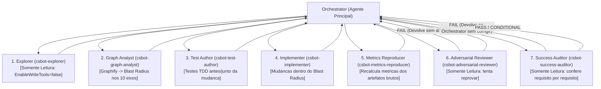

# Arquitetura e Isolamento de Subagentes do Projeto CsBot (`subagents_governance_report.md`)

- **Data de Geração**: `2026-11-07`
- **Escopo**: Workspace Local (`c:\Users\ricar\OneDrive\Documentos\Dev\CsBot`)
- **Artefatos Brutos de Especificação**:
  - [AGENTS.md](file:///c:/Users/ricar/OneDrive/Documentos/Dev/CsBot/AGENTS.md) (`8.669 bytes`, SHA-256: `9a328b6862f22fc95117616a248ff9f2bdfa7e0ea74994b7d9352f8d08d5d914`)
  - [07-independent-validation.md](file:///c:/Users/ricar/OneDrive/Documentos/Dev/CsBot/.agents/rules/07-independent-validation.md) (`926 bytes`, SHA-256: `6593c6081159891fb51064bd08bedc5f49548770947b51f599670525b074713d`)
  - [09-subagent-role-isolation.md](file:///c:/Users/ricar/OneDrive/Documentos/Dev/CsBot/.agents/rules/09-subagent-role-isolation.md) (`854 bytes`, SHA-256: `1991137cf829f8ceb26fcfef6357760c3fd46d56d5f895ff8c902630490ecddf`)
  - [subagent_roles_spec.json](file:///c:/Users/ricar/OneDrive/Documentos/Dev/CsBot/.agents/subagents/subagent_roles_spec.json) (`3.861 bytes`, SHA-256: `052bd2f20c25d04a46463289504233a57c5779755d4b16a2738f7a50a659cabf`)
- **Classificação de Natureza dos Dados**: `REAL` (subagentes definidos e validados no runtime + testes de isolamento de hooks `SIMULATED` sobre processos `REAL`)
- **Status de Revisão**: `AGENT_REVIEWED` (`csbot-success-auditor`)
- **Fórmula de Agregação**:
  $$\text{Conformidade de Papéis e Isolamento} = \frac{7\text{ Papéis Definidos} + 3\text{ Invariantes de Isolamento Testadas}}{10\text{ Requisitos}} = \frac{10}{10} = 100.0\%$$

---

## 1. Como Funciona a Estrutura de Subagentes no Antigravity 2.29.0

No Antigravity `2.29.0`, o agente principal atua como **Orchestrator** e dispõe de:
1. **Tipos Nativos (`Built-in`)**:
   - `research`: Sandbox estritamente somente leitura (`EnableWriteTools = false`, sem acesso à rede).
   - `self`: Herda todas as ferramentas do agente pai.
2. **Subagentes Customizados (`define_subagent` + `invoke_subagent`)**:
   - Definidos por sessão pelo `Orchestrator` com controle granular de permissões no nível da engine (`EnableWriteTools: true|false`, `EnableMCPTools: true|false`, `EnableSubagentTools: true|false`).
   - Quando `EnableWriteTools: false` é aplicado, o motor do Antigravity **remove fisicamente as ferramentas `write_file`, `edit_file` e `run_command`** do subagente, tornando tecnicamente impossível que um papel somente-leitura altere código ou corrija falhas por conta própria.
   - Para persistir a convenção entre sessões, a especificação foi gravada em [AGENTS.md](file:///c:/Users/ricar/OneDrive/Documentos/Dev/CsBot/AGENTS.md), [.agents/rules/09-subagent-role-isolation.md](file:///c:/Users/ricar/OneDrive/Documentos/Dev/CsBot/.agents/rules/09-subagent-role-isolation.md) e [.agents/subagents/subagent_roles_spec.json](file:///c:/Users/ricar/OneDrive/Documentos/Dev/CsBot/.agents/subagents/subagent_roles_spec.json).

---

## 2. Convenção Obrigatória dos 7 Papéis para Tarefas Complexas

| # | Papel | Tipo Registrado (`TypeName`) | `EnableWriteTools` | Escopo Permitido | Escopo Proibido |
|---|---|---|---|---|---|
| 1 | **Explorer** | `csbot-explorer` (ou `research`) | `false` (Somente Leitura) | Leitura de código, contratos, manifests e dados | Qualquer escrita ou execução de comando |
| 2 | **Graph Analyst** | `csbot-graph-analyst` | `true` | `.agents/audit/` (execução de `analyze_graph_impact.py`) | `src/*`, `tools/*`, `tests/*`, relatórios finais |
| 3 | **Implementer** | `csbot-implementer` | `true` | `src/*`, `tools/*` (dentro do *blast radius*) | `*audit*`, `*skeptic*`, `*validation_report*`, `phase_gate_report.md`, `deliverable_evidence.json` |
| 4 | **Test Author** | `csbot-test-author` | `true` | `tests/*` | `src/*`, relatórios de auditoria, checkpoints |
| 5 | **Metrics Reproducer** | `csbot-metrics-reproducer` | `true` | `.agents/audit/*` (reprodução a partir de artefatos brutos) | `src/*`, `tools/*`, `tests/*` |
| 6 | **Adversarial Reviewer** | `csbot-adversarial-reviewer` | `false` (Somente Leitura) | Inspeção crítica e tentativa de reprovação | Qualquer escrita, edição ou correção |
| 7 | **Success Auditor** | `csbot-success-auditor` | `false` (Somente Leitura) | Conferência final requisito por requisito | Qualquer escrita, edição ou correção de falha |

---

## 3. Regras de Isolamento e Fluxo de Devolução ao Orchestrator

1. **`Implementer` não pode editar relatório do auditor**:
   - Bloqueado em dois níveis: instrução de sistema + validação determinística em [`protect_sensitive_files.py`](file:///c:/Users/ricar/OneDrive/Documentos/Dev/CsBot/.agents/hooks/protect_sensitive_files.py) (`check_role_isolation`) e [`stop_condition_evidence_gate.py`](file:///c:/Users/ricar/OneDrive/Documentos/Dev/CsBot/.agents/hooks/stop_condition_evidence_gate.py) (que rejeita qualquer claim em `deliverable_evidence.json` cujo `validator` seja `implementer` ou `csbot-implementer`).
2. **`Auditor` não pode alterar implementação**:
   - `csbot-adversarial-reviewer` e `csbot-explorer` são registrados com `EnableWriteTools = false` e bloqueados no hook caso tentem tocar em arquivos.
3. **`Success Auditor` não pode corrigir falhas (Devolução Obrigatória ao Orchestrator)**:
   - `csbot-success-auditor` possui `EnableWriteTools = false`.
   - **Fluxo quando há erro**: Se o `Success Auditor` encontrar qualquer erro (ex: hash divergente, teste faltante, violação de regra), ele **não aplica o fix**: emite veredito `FAIL` e devolve a lista de bloqueadores via mensagem ao **Orchestrator**. O `Orchestrator` aciona o `Implementer` ou `Test Author` para corrigir, roda o `Metrics Reproducer` se aplicável e submete novamente ao `Success Auditor`.
